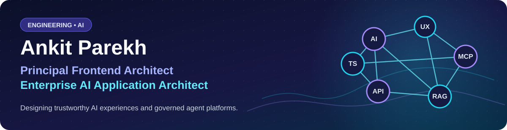
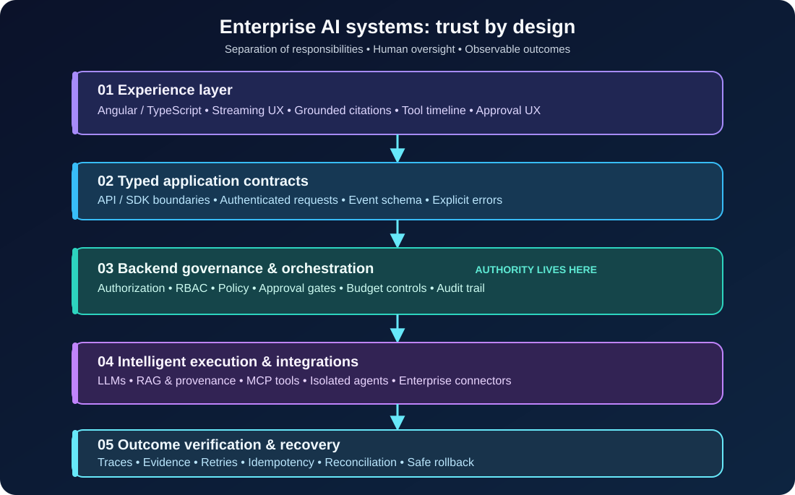

**Designing trustworthy AI products—from Angular experiences to governed agent runtimes.**

[**Live copilot demo**](https://ankitparekh007.github.io/ngx-copilot-platform/) · [**Portfolio & résumé**](https://ankitparekh007.github.io/resume/) · [**LinkedIn**](https://www.linkedin.com/in/akkiparekh)

---

<a href="#featured-projects">Featured projects</a> · <a href="#architecture">Architecture</a> · <a href="#expertise">Expertise</a> · <a href="#review-path">Review path</a>

### Engineering leadership & impact

- **Led 7 developers** and owned architectural decisions across multiple products.
- **Enterprise frontend modernization:** Angular upgrades, reusable components and contracts, and replacing legacy UI dependencies.
- **AI systems:** Public architecture demonstrations for copilot SDKs, RAG provenance, tool approval UX, and versioned agent governance.
- **Proof rather than inflated metrics:** The work below links directly to code, decisions, tests, and deterministic demos; it does not claim unverified production adoption or performance gains.

### At a glance

- **Frontend foundation:** Enterprise Angular, TypeScript, component architecture, state management, reusable contracts, and developer experience.
- **AI systems:** Connecting product-grade interfaces to backend-controlled retrieval, tool execution, approvals, agent workflows, and audit trails.
- **Engineering approach:** Build demonstrable implementations, document tradeoffs, test failure paths, and distinguish prototype evidence from production claims.

> **Design principle:** The frontend explains what an AI system is doing; the backend decides what it is allowed to do.

### ⭐ Featured architecture — start here

Working software • Architecture decisions • Clearly identified prototypes and demos

| Project | What to inspect | Evidence |
| :--- | :--- | :--- |
| **[ngx-copilot-platform](https://github.com/AnkitParekh007/ngx-copilot-platform)** | Angular SDK + copilot platform with streaming, grounded retrieval, tool timelines, approvals, and backend-owned policy boundaries. | [Live demo](https://ankitparekh007.github.io/ngx-copilot-platform/) · [Failure Lab](https://ankitparekh007.github.io/ngx-copilot-platform/failure-lab) · [Architecture proof](https://github.com/AnkitParekh007/ngx-copilot-platform/blob/main/docs/public-proof.md) |
| **[org-ai-force](https://github.com/AnkitParekh007/org-ai-force)** | Enterprise Angular/NestJS agent-workspace **prototype**: governance, role-based boundaries, RAG-ready services, MCP-style tools, and browser-worker scenarios. | [Architecture](https://github.com/AnkitParekh007/org-ai-force/blob/main/docs/system-architecture.md) · [Security model](https://github.com/AnkitParekh007/org-ai-force/blob/main/docs/security-model.md) |
| **[agent-studio](https://github.com/AnkitParekh007/agent-studio)** | Agent application factory with versioned approvals, provider-neutral runtime boundaries, provisioning, publication, and revocation rules. | [Architecture handbook](https://ankitparekh007.github.io/agent-studio/) · [Public proof](https://github.com/AnkitParekh007/agent-studio/blob/main/docs/public-proof.md) |
| **[frontend-ai-patterns](https://github.com/AnkitParekh007/frontend-ai-patterns)** | Reusable AI frontend patterns for streamed responses, citations, tools, approvals, recovery, and guardrails. | [Explore patterns](https://ankitparekh007.github.io/frontend-ai-patterns/) |
| **[angular-ai-copilot-starter](https://github.com/AnkitParekh007/angular-ai-copilot-starter)** | Angular reference UX for Ask/Plan/Execute/Debug, grounded answers, action approvals, and tool visibility. | [Explore starter](https://ankitparekh007.github.io/angular-ai-copilot-starter/) |
| **[ai-tools-cheatsheets](https://github.com/AnkitParekh007/ai-tools-cheatsheets)** | Open engineering guide to AI coding tools, MCP, team workflows, prompt conventions, and safe adoption. | [Read the handbook](https://ankitparekh007.github.io/ai-tools-cheatsheets/) |

**Evidence boundary:** Public demos, static handbooks, deterministic mock scenarios, and local prototypes are not claims of production customer deployment. Consult each repository's current CI, docs, and implementation notes before assessing readiness.

### How I think about enterprise AI architecture

The critical design decision is **keeping authorization, tool execution, approvals and audit authority on the backend**. A capable frontend makes states, evidence and recovery clear; it does not grant itself permission to act.

### Core expertise

| Area | Technologies & design concerns |
| :--- | :--- |
| **Frontend architecture** | Angular, TypeScript, RxJS, Signals, scalable UI components, SDK design, React/Next.js |
| **AI applications** | LLM integration, RAG, source attribution, MCP, tool calling, agent orchestration |
| **Trust & governance** | Backend authorization, RBAC, human approvals, audit trails, safe recovery, least privilege |
| **Backend & data** | Node.js, NestJS, Python/FastAPI, PostgreSQL, Supabase, pgvector, Redis |
| **Engineering delivery** | Docker, Kubernetes, CI/CD, Playwright, architecture documentation, testability |

### Verifiable engineering evidence

| Engineering principle | Evidence | Scope |
| --- | --- | --- |
| Copilot SDK and backend-owned policy | [ngx-copilot proof](https://github.com/AnkitParekh007/ngx-copilot-platform/blob/main/docs/public-proof.md) | Architecture, test references and reproducible demos |
| Explicit failure and recovery UX | [Failure Lab](https://ankitparekh007.github.io/ngx-copilot-platform/failure-lab) | Deterministic scenarios, not production incidents |
| Governed agent lifecycle | [Agent Studio evidence](https://github.com/AnkitParekh007/agent-studio/blob/main/docs/public-proof.md) | Versioned approvals, publishing and revocation rules |
| Backend trust boundaries | [Org AI Force security model](https://github.com/AnkitParekh007/org-ai-force/blob/main/docs/security-model.md) | Prototype architecture, not certified deployment |

### More work worth exploring

- **[Agentic Engineering Playbook](https://github.com/AnkitParekh007/Agentic-Engineering-Playbook)** — runnable learning systems spanning model gateways, RAG, tool orchestration, and browser automation.
- **[devdocs-forge-agent](https://github.com/AnkitParekh007/devdocs-forge-agent)** — local-first documentation agent with reviewable output and source attribution.
- **[interviewOps](https://github.com/AnkitParekh007/interviewOps)** — Angular/TypeScript application exploring provider abstraction, structured content, and safeguards.
- **[shade-shifter](https://github.com/AnkitParekh007/shade-shifter)** — cross-disciplinary product R&D exploring Flutter, BLE, embedded hardware, and CAD.
- **[Agents Foundry](https://github.com/Agents-Foundry)** — organization-level work on governed employee agents and the supporting control-plane architecture.

### A quick review path

**30 seconds:** Explore [ngx-copilot-platform](https://github.com/AnkitParekh007/ngx-copilot-platform) and its [live demo](https://ankitparekh007.github.io/ngx-copilot-platform/).

**3 minutes:** Compare the [copilot Failure Lab](https://ankitparekh007.github.io/ngx-copilot-platform/failure-lab), [Org AI Force security model](https://github.com/AnkitParekh007/org-ai-force/blob/main/docs/security-model.md), and [Agent Studio governance proof](https://github.com/AnkitParekh007/agent-studio/blob/main/docs/public-proof.md).

**10 minutes:** Inspect repository implementation, architecture decisions, automated tests, CI runs, and clearly marked demo-versus-production boundaries.

### Let's connect

I'm interested in **Principal/Staff Frontend Architecture, Enterprise Technical Architecture, and AI Application Architecture** opportunities—including remote international roles and relocation to **Germany, Ireland, or the UAE**.

[**View portfolio**](https://ankitparekh007.github.io/resume/) · [**Connect on LinkedIn**](https://www.linkedin.com/in/akkiparekh) · [**Email me**](mailto:akki77parekh@gmail.com)

**Building AI systems that are usable, explainable, governable, and engineered to recover.**

